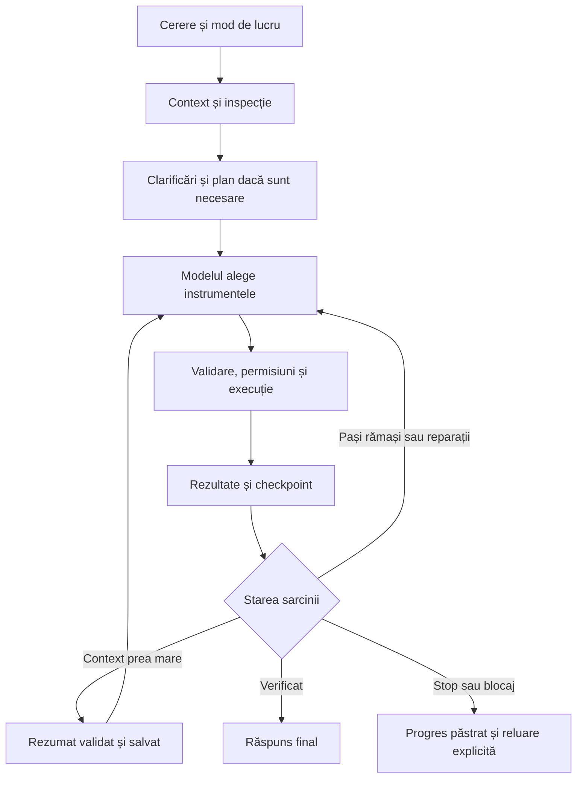

# Workflow-ul agentului Godot AI

Implementare nativă GDScript, 30 octombrie 2026. Workflow-ul urmează modelul
funcțional analizat la Ziva: context, inspecție, plan, instrumente, rezultate,
verificare și continuare. Codul este al agentului Godot AI; nu necesită Pi,
Bun, Node.js, shell sau PRoot. Tabul Ziva rămâne independent.

[Afișarea mesajelor, operațiilor și rezultatelor în chat](chat-presentation.md).

## Moduri

| Mod | Comportament |
| --- | --- |
| Auto | Inspectează, publică un plan înaintea modificărilor și lucrează până la verificare sau la un blocaj concret. |
| Default | Răspunde direct la cereri simple; planifică sarcinile complexe și le implementează. |
| Plan | Inspectează și colectează cerințe prin întrebări interactive; publică un plan pentru implementare sau rafinare. |
| Ask | Citește, caută și explică. Nu modifică proiectul, nu rulează jocul, teste, shell sau generări. |

Ask păstrează controlul și când YOLO este activ: instrumentele de execuție
sunt excluse din catalog, iar dispatcher-ul verifică independent modul.
`asset_status` și `asset_wait` sunt excluse deoarece pot descărca și importa
automat rezultate. Selectarea Ask nu schimbă identitatea conversațiilor Plan
mai vechi. Se poate folosi și `/ask`.

## Bucla de lucru

Planul și dovezile verificării rămân mecanisme separate. Un apel de rulare,
o scriere reușită sau un răspuns final al modelului nu reprezintă singure o
verificare a gameplay-ului. Criteriile declarate sunt confirmate prin rezultate
reale ale instrumentelor. Plan, întrebări, verificare, subagenți și ciclul
playtest existente sunt păstrate.

Nu există un plafon general de pași în rulările normale. Dacă modelul încearcă
să încheie cu planul neterminat, primește până la trei reamintiri cu pașii reali.
Repetarea fără progres, un blocaj sau Stop au rezultate distincte de finalizare.

## Queue și Steer

- **Queue:** mesajul trimis în timpul lucrului așteaptă o sarcină nouă. Nu
  oprește agentul. Pe desktop, Enter păstrează acest comportament.
- **Steer:** `/steer cerința`, Ctrl/Cmd+Enter sau butonul **În task** de pe un
  mesaj în așteptare ajustează sarcina curentă. Pe telefon se poate trimite
  mesajul și apoi alege **În task**.
- **În coadă:** mută o intervenție înapoi între sarcinile care vor rula după
  încheierea celei curente. Editarea/restaurarea și eliminarea rămân disponibile.

Intervențiile sunt aplicate la o limită sigură între operații. O operație deja
confirmată rămâne păstrată. Apelurile încă neexecutate primesc rezultatul
`steered`, fără efecte, pentru a închide corect perechile apel–rezultat înainte
de mesajul utilizatorului. După o aprobare este verificată din nou existența
unei intervenții, înaintea modificării. Agentul reevaluează acțiunea în contextul
cerinței actualizate.

Intervenția păstrează același `turn_id`, atașamentele și referințele. Mai multe
intervenții sunt livrate în ordinea trimiterii. Cererea inițială nu dispare când
lista mesajelor recente începe după o intervenție. Modelul, modul și efortul
trebuie să corespundă sarcinii active; altfel mesajul intră în Queue.

Intervențiile sunt legate de sarcina pentru care au fost trimise și nu se pot
aplica unei alte sarcini care folosește același model. La Stop/eșec, mesajele
în așteptare rămân vizibile, pe pauză. Pornirea altei sarcini nu reia automat
coada. Conversația salvată păstrează intervențiile deja livrate; mesajele încă
în așteptare sunt în memoria panoului și nu sunt garantate după închiderea
procesului. Pentru companion, o intervenție este pusă în Queue; noul mecanism
Steer este implementat în harness-ul direct din Godot.

## Context în sarcini lungi

Între loturi de instrumente, harness-ul poate compacta semantic o parte veche
a aceleiași sarcini. Rezumatul este produs în loturi limitate, validat și salvat
atomic înainte de folosire. Sunt păstrate:

- cererea originală și intervențiile, textual, ca mesaje ale utilizatorului;
- ultimul grup complet de apeluri și rezultate;
- istoricul integral, planul, criteriile și dovezile verificării;
- registrul efectelor confirmate și identitatea joburilor plătite.

Nu se taie între un apel și rezultatele sale. Un rezumat invalid, o salvare
eșuată, schimbarea contextului sursă sau Stop păstrează rezumatul precedent și
istoricul. Nu se trimite mai departe un rezumat parțial prezentat drept complet.
Un overflow confirmat permite o recuperare cu context efectiv redus; nu se
retrimit automat instrumentele sau generările. Estimarea ferestrei rămâne
euristică; un ultim lot sau instrucțiuni foarte mari pot cere un model cu o
fereastră mai mare.

Compactarea automată respectă preferința existentă și metadatele disponibile
despre fereastra modelului; în lipsa lor recuperarea folosește un buget
conservator, fără a pretinde că a măsurat limita reală. Compactarea manuală
rămâne disponibilă între sarcini. Tokenii compactărilor automate
sunt incluși în totalul sarcinii; în lipsa raportării furnizorului sunt marcați
estimați. Schimbarea modelului selectat pentru următorul mesaj nu elimină
consumul sarcinii încă în desfășurare.

## Dovezi și stare de livrare

Rapoartele acestei etape sunt în `.ai-qa/native-workflow-20261030/`:
`runtime-verified.log`, `phone/phone_compact/editor-report.json`,
`phone/phone_compact/workflow-queue-steer.png` și `all-final/narrow/`.

Verificările folosesc sursele reale ale panoului/harness-ului și furnizori
simulați. Capturile sunt din editorul Linux, inclusiv cu scalare de telefon.
Nu reprezintă o probă live DeepSeek/Runware sau Android fizic. Nu s-a compilat
și nu s-a livrat un APK în această etapă.
